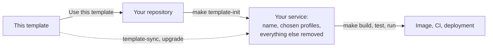

# rust-service-template-rest

Rust REST API service template on Tokio and axum: code-first OpenAPI, safe runtime defaults, observability, CI, and instructions for coding agents.

Repository: https://github.com/Dankosik/rust-service-template-rest

<!-- template:begin source-template:readme-template-overview -->
[](https://github.com/Dankosik/rust-service-template-rest/actions/workflows/ci.yml)
[](rust-toolchain.toml)
[](LICENSE)

A starting point for a backend microservice in Rust that you can put behind real
traffic. A new repository starts with the decisions a production HTTP service
needs already made, tested and written down: how requests are bounded, how
the service shuts down, how errors look on the wire, how the API contract
stays true, what operators can observe, and what CI proves before a change
merges. You pick the capabilities your service needs (PostgreSQL, background
jobs, NATS JetStream, Redis, S3, gRPC, OIDC authentication, webhooks), and the
initializer removes everything else. The result is ordinary Rust code that you
own, with no framework to upgrade and no dead feature flags.

## Why this template exists

Most Rust web starters stop at a router and a `main.rs`. The work that keeps a
service up comes later and gets rediscovered on every project: a request with
no deadline holds a connection forever, a slow dependency fills memory, a
deploy cuts off in-flight requests, an OpenAPI file drifts from the handlers,
a log line leaks a token, a panic returns an empty response. This template
solves those once, in code, with tests that keep them solved.

Coding agents now write much of the code in a service, and they reproduce
whatever the repository makes easy. So the same decisions are also written as
instructions for agents: [AGENTS.md](AGENTS.md), focused skills, and workflows
that tell Claude Code, Codex, Cursor, Qwen Code, Grok and OpenCode where each
change belongs and what proof finishes it. Lints and CI hold agents and people
to the same rules.

The design is ported from the sibling Go template,
[go-service-template-rest](https://github.com/Dankosik/go-service-template-rest),
so services built from either follow the same operating decisions, and their
JetStream event wire format is checked against the Go encoder and decoder.

## What you get

**Every service starts with:**

- **HTTP server on axum and hyper** with connection, header, body and in-flight
  limits; `503` load shedding with `Retry-After`, a request deadline (`504`),
  and panic recovery (`500`) instead of a dropped connection.
- **Code-first OpenAPI** generated from Rust types with utoipa and committed to
  [`api/openapi/service.yaml`](api/openapi/service.yaml). CI fails when the
  document is stale and refuses unapproved breaking changes.
- **One error format**: every failure is an `application/problem+json` body
  from a closed catalog, carrying the request id and never echoing input.
- **Health and readiness**: `/health/live` and `/health/ready`, with readiness
  tied to the dependencies the service actually retains.
- **Observability**: structured JSON logs, OpenTelemetry traces over OTLP, and
  Prometheus metrics on a separate private listener.
- **Graceful shutdown**: a stop signal drains admitted requests, joins
  background tasks and flushes telemetry within a fixed budget.
- **Typed configuration**: TOML files plus `APP__SECTION__KEY` environment or
  secret-file overrides; unknown keys and secrets in files fail startup.
- **Container image**: a distroless, non-root runtime image from a pinned
  Dockerfile, with Trivy scanning and a CycloneDX SBOM.
- **CI on GitHub Actions** that runs only the checks a change touches: format,
  Clippy with warnings as errors, tests, cargo-deny, unused dependencies,
  secret scanning, workflow linting, and CodeQL.

**Optional capabilities, chosen once at initialization:**

| Capability | Selection | Built on |
| --- | --- | --- |
| PostgreSQL with migrations and compile-time checked queries | `DATABASE=postgres` | sqlx |
| Durable background jobs and a worker binary | `JOBS=postgres` | PostgreSQL |
| HTTP `Idempotency-Key` support | `HTTP_IDEMPOTENCY=postgres` | PostgreSQL |
| Inbound bearer authentication | `AUTHN=oidc-jwt` or `oidc-introspection` | OIDC, JWKS, RFC 7662 |
| Outbound HTTP client with budgets and TLS | `OUTBOUND_HTTP=bounded` | hyper, rustls |
| Machine-to-machine OAuth2 with token exchange | `OUTBOUND_AUTH=oauth2-client-credentials` | `private_key_jwt`, RFC 8693 |
| gRPC alongside REST | `GRPC=enabled` | tonic, Buf |
| Service-to-service tokens for gRPC | `SERVICE_AUTH=jwt` | ES256 JWT |
| Typed event publishing and consuming | `MESSAGING=nats-jetstream` | NATS JetStream |
| Transactional outbox | `OUTBOX=postgres` | PostgreSQL, JetStream |
| Signed outbound and inbound webhooks | `WEBHOOKS=durable`, `INBOUND_WEBHOOKS=standard-webhooks` | Standard Webhooks |
| Cache client | `CACHE=redis` | Redis or Valkey |
| Object storage | `OBJECT_STORAGE=s3` | Amazon S3, Cloudflare R2, Railway Buckets |

Each capability ships with its guide, a decision record that explains the
library choice, configuration, tests (against a real dependency in a container
where it has one), and its CI gates. A selected capability stays inert until it is configured.

## How it works



1. **Create a repository** from this template with GitHub's *Use this template*
   button, or clone it.
2. **Run the initializer once.** It renames the packages and binaries, sets
   the description and owners, regenerates OpenAPI, and deletes the code,
   tests, configuration, documentation and dependencies of every capability
   you did not select. It never commits; you review the diff.
3. **Build features in the generated service.** The
   [first production feature](docs/first-production-feature.md) walkthrough
   adds a feature crate, its contract and its tests. One composition root
   wires state, and a route whose state is missing fails to compile.
4. **Adopt later template improvements** when you want them: portable
   tooling and agent instructions through `template-sync`, and runtime changes
   through reviewed Git merges with the
   [runtime upgrade guide](docs/template-upgrade.md).

## Is it a fit?

It fits a team that wants a Rust HTTP microservice with explicit operational
behavior, a contract that clients can trust, and coding agents that work inside
clear boundaries.

What it asks in return:

- **It is opinionated.** Resource limits, error formats, configuration rules
  and layering are fixed choices. Changing one means changing code and its
  tests, not a flag.
- **It is a template, not a framework.** After initialization the code is
  yours. That removes framework lock-in, and it also means improvements arrive
  as reviewed merges, not as a version bump.
- **The tooling is broad.** Initialization and checks use Python 3.11+, GNU
  Make and Docker besides Cargo, and the full CI takes tens of minutes.
- **The toolchain is pinned** to Rust 1.99 and edition 2024 and moves in
  deliberate, reviewed steps.
- **No CORS by default.** Browser cross-origin requests are refused until the
  service adds a policy.

If you want a batteries-included web framework with an ORM, generators and
server-rendered views, a framework such as [Loco](https://loco.rs) fits better.
<!-- template:end source-template:readme-template-overview -->

## Quickstart

Install Git, Python 3.11+, GNU Make and rustup. Use the pinned toolchain in
`rust-toolchain.toml`; Cargo commands use the committed lockfile.

```sh
make build
make test
make run
```

`make run` starts the service with `env/config/local.toml` and needs no
external services. Then check it:

```sh
curl http://127.0.0.1:8080/health/live
curl http://127.0.0.1:8080/health/ready
curl http://127.0.0.1:9090/metrics
```

Metrics and a second liveness probe live on the separate diagnostics listener
on port `9090`, which a deployment keeps private. `APP__SECTION__KEY` overrides
any configuration key, from the environment or from a file of that name under
`--secrets-dir`. [Configuration](docs/configuration-source-policy.md) and
[Runtime Lifecycle](docs/architecture/runtime-lifecycle.md) own the details.

## Create a service from the template

Initialize a clean checkout once. Fetch the locked dependencies while
connected; the initializer then runs offline:

```sh
cargo fetch --locked
make template-init SERVICE_NAME=catalog-api \
  REPOSITORY=https://github.com/example/catalog-api \
  DESCRIPTION='Catalog API' CODEOWNER=@example/platform \
  DATABASE=none AGENT_HARNESS=claude
```

`DATABASE` defaults to `none`. `AGENT_HARNESS` defaults to `all` and accepts
`core`, `codex`, `claude`, `qwen`, `cursor`, `grok`, `opencode`, or `all`. The
capability selections are described with their owning guides below.

Initialization changes the package and executable identity, configuration
defaults, OpenAPI, owners and local command data, and removes unselected packs.
It keeps the stable `crates/service` directory and library name.
`template.lock` records the source provenance and selected profiles, not
current dependency versions or runtime configuration. Running it again with
the same inputs changes nothing; changing an established profile is a separate
operation. The command never stages or commits the result: review and commit
the diff. [Initialization and portable updates](docs/template-sync.md) owns
admission, prerequisites, refusal and recovery.

## Profiles and local owners

<!-- template:begin grpc:readme-grpc-profile -->
`GRPC=enabled` retains native tonic RPCs on a separate listener that uses the
shared HTTP accept loop, generated contracts, standard health, lazy clients
and the process drain. It is inert until explicitly enabled and registered.
`GRPC=none` removes the complete capability. The [gRPC guide](docs/grpc.md)
owns registration, handler validation, TLS/plaintext, authentication and
generation; the [decision record](docs/grpc-decisions.md) explains the
boundaries.
<!-- template:end grpc:readme-grpc-profile -->

<!-- template:begin webhooks-common:readme-webhooks-profiles -->
The optional webhook profiles are selected by `WEBHOOKS=none|durable` and
`INBOUND_WEBHOOKS=none|standard-webhooks`, both defaulting to `none`. Each
requires PostgreSQL and jobs; durable outbound additionally requires bounded
outbound HTTP. Retention is inert until static environment-backed endpoints and,
for inbound processing, explicit service/worker consumer bindings exist. See
the selected direction guide.
<!-- template:end webhooks-common:readme-webhooks-profiles -->
<!-- template:begin messaging:docs-readme-messaging-profile -->
`MESSAGING=nats-jetstream` retains typed JetStream publication and consumption
without PostgreSQL or jobs. It is inert until configured and reuses the retained
`jobs-worker`; it does not add a sample event or HTTP route. The [durable
messaging guide](docs/durable-messaging.md) owns Go interoperability, operator
topology, handler idempotency, and the selected worker's limits. `OUTBOX` is a
separate PostgreSQL/jobs extension and is unavailable in a messaging-only
selection.
<!-- template:end messaging:docs-readme-messaging-profile -->
<!-- template:begin cache:docs-readme-cache-profile -->
`CACHE=redis` retains a bytes-only Redis-protocol cache client. It is inert
until `APP__CACHE__DSN` is set, and it does not add a sample key or HTTP route.
A miss or an unavailable server degrades to the source of truth. The [cache
guide](docs/cache.md) owns configuration, budgets, and removal; the [decision
record](docs/cache-decisions.md) records the library choices. `CACHE=none`
removes the capability.
<!-- template:end cache:docs-readme-cache-profile -->
<!-- template:begin object-storage:docs-readme-object-storage-profile -->
`OBJECT_STORAGE=s3` retains an S3-compatible object storage client for one
bucket at one fixed endpoint: Amazon S3, Cloudflare R2, or Railway Buckets. It
is inert until `object_storage.provider` is set, sends nothing at startup, and
is not a readiness dependency. The [object storage guide](docs/object-storage.md)
owns configuration, failure semantics, and proof; the [decision
record](docs/object-storage-decisions.md) records the library and provider
choices. `OBJECT_STORAGE=none` removes the capability.
<!-- template:end object-storage:docs-readme-object-storage-profile -->
<!-- template:begin service-auth:docs-readme-service-auth-profile -->
`SERVICE_AUTH=jwt` requires `GRPC=enabled` and retains caller-signed service
tokens: a caller signs a 60-second ES256 token for one receiver, which pins
each caller's keys, admits each method only to the callers its table names,
and gives the handler the caller's name. It is inert until
`service_auth.mode = "jwt"`. The [service authentication
guide](docs/service-authentication.md) owns keys, the caller table and
outbound tokens; the [decision record](docs/service-authentication-decisions.md)
records the contract. `SERVICE_AUTH=none` removes the capability.
<!-- template:end service-auth:docs-readme-service-auth-profile -->
<!-- template:begin outbox:docs-readme-outbox-profile -->
`OUTBOX=postgres` requires `DATABASE=postgres`, `JOBS=postgres`, and
`MESSAGING=nats-jetstream`. It records publication intent in the business
transaction and gives it reserved worker capacity. Its recovery and rollback
rules are in the [transactional outbox guide](docs/postgres-transactional-outbox.md).
<!-- template:end outbox:docs-readme-outbox-profile -->

<!-- template:begin webhooks:readme-webhooks-outbound-guide -->
The outbound direction is documented in
[Outbound webhooks](docs/outbound-webhooks.md).
<!-- template:end webhooks:readme-webhooks-outbound-guide -->

<!-- template:begin inbound-webhooks:readme-webhooks-inbound-guide -->
The inbound direction is documented in
[Inbound webhooks](docs/inbound-webhooks.md).
<!-- template:end inbound-webhooks:readme-webhooks-inbound-guide -->

<!-- template:begin outbound-auth:readme-outbound-auth-profile -->
The optional outbound machine-authentication profile is selected by
`OUTBOUND_AUTH=none|oauth2-client-credentials`, defaulting to `none`. It
authenticates only with a private key, never a client secret, and carries a
verified user's context downstream through RFC 8693 token exchange.
Selecting it also retains bounded outbound HTTP, but starts no provider
call, task, listener, or readiness dependency. Concrete integrations compose
their own private authenticated client. See [Service-to-service
authentication](docs/service-to-service-authentication.md) for the mandate,
[Outbound machine authentication](docs/outbound-machine-authentication.md)
for adoption, and its [decision
record](docs/outbound-machine-authentication-decisions.md).
<!-- template:end outbound-auth:readme-outbound-auth-profile -->

The initial database and adapter selections are recorded in `template.lock`;
the source checkout without a lock carries PostgreSQL and the optional adapters. A retained
PostgreSQL profile remains inert until configured. The
[local persistence record](docs/architecture/persistence.md) describes its
availability, and [PostgreSQL Validation](docs/validation/postgres.md) names
proof only when that profile exists. An absent profile contributes no provider,
migrator, configuration, database tests or executable database gate.

## Build, check and ship

`make help` lists the commands the selected profiles provide.
`make/service.mk` owns the service package and binary, image tag,
configuration and OpenAPI paths, and local recipes; `make/template.mk` owns the
portable standard commands. The [command policy](docs/build-test-and-development-commands.md)
names what each command proves. Ordinary development finishes after the
matching build and tests; `ALLOW_FULL=1 make check` is the explicit aggregate,
and container-backed work additionally requires `ALLOW_HEAVY=1`.

Build the runtime image from the pinned Dockerfile:

```sh
ALLOW_HEAVY=1 make runtime-image-build
```

Running, scanning and publishing the image require the matching decision and
authority. [CI/CD Production Readiness](docs/ci-cd-production-ready.md) and
the [Railway Deployment Profile](docs/railway-deployment-profile.md) hold the
gate and rollout decisions. Initialization does not deploy a service, and the
[Production Contract](docs/production-contract.md) lists what a service
decides before production.

## Portable updates

Use one committed template checkout as the source and this service as target:

```sh
scripts/template-sync.sh --check --from /path/to/template --repo .
scripts/template-sync.sh --apply --from /path/to/template --repo .
```

The ownership manifest selects portable files. Runtime and Cargo sources, local
configuration, OpenAPI, migrations, README, owners, CI activation and
architecture remain service-owned. Cargo, toolchain, vendor and Docker changes
outside that manifest require explicit service adoption; portable sync is not
a runtime upgrade. `--instructions-only` adopts selected instruction and
adapter views while leaving tooling untouched. Commit adopted changes before
checking parity; dirty owned paths refuse even when their bytes already match.
See [synchronization](docs/template-sync.md) for local skills, managed settings
leaves, selective dirty refusal and recovery. The separate
[runtime upgrade route](docs/template-upgrade.md) reconstructs full rendered
baselines and prepares reviewed native Git merges from a trusted external
template checkout.

## Working with coding agents

[AGENTS.md](AGENTS.md) is the contract for every agent and person: who decides
what, how much validation finishes a change, and which document owns each kind
of decision. The [Workflow Router](docs/spec-first-workflow.md) selects the
phase for larger work, and [Agent Harness](docs/agent-harness.md) describes
native delegation. Canonical skills and roles live under `.agents`; only the
adapters selected in `template.lock` are installed and checked by
`make check-instructions`. `core` uses the canonical instructions without a
product adapter. The adapter documents under
[docs/agent-harness](docs/agent-harness) describe each product.

Each skill is a focused method an agent loads when a change reaches its
concern:

| Skill | Leading concept | Use it for |
| --- | --- | --- |
| [rust-coder](.agents/skills/rust-coder/SKILL.md) | Earliest owner | Implementing an authorized change with its tests and cleanup |
| [rust-idiomatic](.agents/skills/rust-idiomatic/SKILL.md) | Contracts | Ownership, borrowing, trait bounds, error identity, `Send`/`Sync` boundaries |
| [rust-tokio](.agents/skills/rust-tokio/SKILL.md) | Task ownership | Spawning, `select!`, locks across awaits, channels, blocking work, shutdown order |
| [rust-axum](.agents/skills/rust-axum/SKILL.md) | Route tree | Routes, extractors, layers, fallbacks, the hardened chain |
| [rust-api-contract](.agents/skills/rust-api-contract/SKILL.md) | Observable contract | OpenAPI operations, security decisions, problem responses, drift and compatibility |
| [rust-errors](.agents/skills/rust-errors/SKILL.md) | Failure semantics | Typed errors, problem codes, exit codes, fail vs degrade |
| [rust-config](.agents/skills/rust-config/SKILL.md) | One key, one owner | Adding or validating a configuration key or secret source |
| [rust-observability](.agents/skills/rust-observability/SKILL.md) | Operator evidence | Log fields, spans, metrics, probes, cardinality, privacy |
| [rust-reliability](.agents/skills/rust-reliability/SKILL.md) | Budget arithmetic | Deadlines, retries, overload, readiness, drain, shutdown budgets |
| [rust-security](.agents/skills/rust-security/SKILL.md) | Attacker path | Identity, secrets, caller input, exposure, amplification |
| [rust-testing](.agents/skills/rust-testing/SKILL.md) | Observable failure | Proving layer, deterministic time, process tests |
| [rust-performance](.agents/skills/rust-performance/SKILL.md) | Evidence | Latency, throughput, allocation, allocator and profile decisions |
| [rust-debugging](.agents/skills/rust-debugging/SKILL.md) | Causality | Failures, hangs, flakes, wrong output |
| [rust-structural-quality](.agents/skills/rust-structural-quality/SKILL.md) | Deletion test | New crates, modules, traits, layers, helpers, placement |
| [rust-dependencies](.agents/skills/rust-dependencies/SKILL.md) | Verified resolution | New crates or features, toolchain pin, library vs template code |
| [rust-verification](.agents/skills/rust-verification/SKILL.md) | Evidence boundary | What existing evidence supports a claim |
| [rust-delivery-platform](.agents/skills/rust-delivery-platform/SKILL.md) | Gate chain | CI jobs, tool pins, the Dockerfile, image checks, publication, deployment profile |
| [rust-sqlx](.agents/skills/rust-sqlx/SKILL.md) | Durable outcome | PostgreSQL pool, DSN admission, transactions, commit outcome, migrations, database-backed proof |
| [merge-conflict-resolution](.agents/skills/merge-conflict-resolution/SKILL.md) | Intent reconstruction | Conflicted hunks in a merge, rebase, cherry-pick, or revert |

Capability methods apply only when the local architecture provides their
capability. [Skill Authoring](docs/skill-authoring.md) owns their shape and
[Prompt Maintenance](docs/prompt-maintenance.md) owns instruction changes.

## Documentation

- Architecture: [Repository Architecture](docs/repo-architecture.md), [Component Boundaries](docs/architecture/boundaries.md), [HTTP Architecture](docs/architecture/http.md), [Integration Boundaries](docs/architecture/integration.md), and [Project Structure](docs/project-structure-and-module-organization.md).
- Building features: [First Production Feature](docs/first-production-feature.md), [Backend Library Selection](docs/backend-library-selection.md), and [Backend Utility Recipes](docs/backend-utility-recipes.md).
- Shipping: [Production Contract](docs/production-contract.md), [Validation Routing](docs/validation-routing.md), [Commands](docs/build-test-and-development-commands.md), and [CONTRIBUTING.md](CONTRIBUTING.md).
- Template lifecycle and agents: [Initialization and portable updates](docs/template-sync.md), [Runtime upgrades](docs/template-upgrade.md), and [Prompt Composition](docs/prompt-composition.md).

## Community

Use the repository issue forms and follow the [Code of Conduct](CODE_OF_CONDUCT.md).
Report vulnerabilities privately through [SECURITY.md](SECURITY.md).
Released under the [MIT License](LICENSE).

Template provenance:
[rust-service-template-rest](https://github.com/Dankosik/rust-service-template-rest),
which ports decisions from
[go-service-template-rest](https://github.com/Dankosik/go-service-template-rest).
These links describe origin, not the current service's owners or support route.
