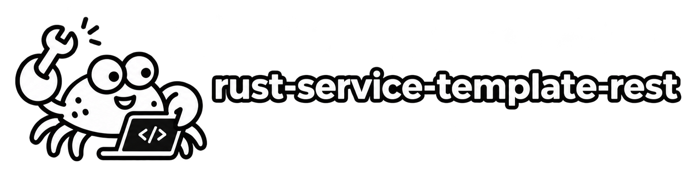

<!-- template:begin source-template:readme-banner -->
<p align="center">
  
</p>

<p align="center">
  <a href="#start-a-service">Start a service</a> ·
  <a href="#how-agents-work-here">How agents work here</a>
</p>
<!-- template:end source-template:readme-banner -->

# rust-service-template-rest

Rust REST API service template on Tokio and axum, built to be developed by coding agents.

Repository: https://github.com/Dankosik/rust-service-template-rest

<!-- template:begin source-template:readme-template-overview -->
[](https://github.com/Dankosik/rust-service-template-rest/actions/workflows/ci.yml)
[](rust-toolchain.toml)
[](LICENSE)

Coding agents now write most of a service's code, and they repeat whatever the
repository makes easy. This template makes the production path the easy one.
The decisions a Rust microservice needs are already made, enforced by tests,
lints and CI, and written as instructions the agent follows. You describe the
behavior. The agent builds it inside fixed boundaries and proves it before
merge.

Works with Claude Code, Codex, Cursor, Qwen Code, Grok and OpenCode.

## Start a service

1. Create a repository with **Use this template**.
2. Initialize it once: ask your agent, or run

   ```sh
   cargo fetch --locked
   make template-init SERVICE_NAME=catalog-api \
     REPOSITORY=https://github.com/example/catalog-api \
     DESCRIPTION='Catalog API' CODEOWNER=@example/platform \
     AGENT_HARNESS=claude
   ```

   The initializer renames the service, keeps the profiles you select, and
   deletes the rest. It never commits, so you review the diff first.
   [Initialization](docs/template-sync.md) lists every option.
3. Describe the first feature to your agent.
<!-- template:end source-template:readme-template-overview -->

## How agents work here

- [AGENTS.md](AGENTS.md) is the contract: what the agent decides on its own,
  what it asks you, and how much proof finishes a change.
- [Skills](.agents/skills) give one focused method per concern: Tokio tasks,
  axum routes, the API contract, errors, configuration, observability,
  reliability, security, SQL, tests, performance and dependencies.
- Larger work follows a [spec-first workflow](docs/spec-first-workflow.md):
  research, specification, design, plan, implementation and review.
- Lints, tests and CI hold the agent to the same rules as a person. CI runs
  only the checks a change touches.
- One canonical instruction set lives in `.agents`. Initialization installs only
  the adapters `AGENT_HARNESS` selects.

## What the service includes

- An axum HTTP server with connection, body and in-flight limits, `503` load
  shedding, a request deadline and panic recovery.
- OpenAPI generated from Rust and committed. CI fails on drift and on
  unapproved breaking changes.
- Application errors use `application/problem+json` from a closed catalog.
  Readiness reports an unavailable instance with `503 text/plain`.
- Health and readiness probes, JSON logs, OpenTelemetry traces, Prometheus
  metrics on a private listener, and [SLO burn-rate alerts](docs/alerting.md)
  with runbooks.
- Graceful shutdown, typed configuration, and a distroless image with a scan
  and an SBOM.

## Profiles

Optional capabilities are chosen at initialization and recorded in
`template.lock`. Unselected ones are deleted; selected ones stay inert until
configured.

<!-- template:begin postgres:readme-postgres-profile -->
- `DATABASE=postgres`: PostgreSQL through sqlx, with migrations and
  compile-time checked queries ([`infra-postgres`](crates/infra-postgres)).
<!-- template:end postgres:readme-postgres-profile -->
<!-- template:begin jobs:readme-jobs-profile -->
- `JOBS=postgres`: durable background jobs and a worker binary
  ([`infra-jobs`](crates/infra-jobs)).
<!-- template:end jobs:readme-jobs-profile -->
<!-- template:begin http-idempotency:readme-http-idempotency-profile -->
- `HTTP_IDEMPOTENCY=postgres`: `Idempotency-Key` support
  ([`infra-idempotency-store`](crates/infra-idempotency-store)).
<!-- template:end http-idempotency:readme-http-idempotency-profile -->
<!-- template:begin authn:readme-authn-profile -->
- `AUTHN=oidc-jwt|oidc-introspection`: bearer authentication against an OIDC
  provider ([`infra-bearerauthn`](crates/infra-bearerauthn)).
<!-- template:end authn:readme-authn-profile -->
<!-- template:begin outbound-http:readme-outbound-http-profile -->
- `OUTBOUND_HTTP=bounded`: an HTTPS client with budgets
  ([`infra-outbound-http`](crates/infra-outbound-http)).
<!-- template:end outbound-http:readme-outbound-http-profile -->
<!-- template:begin outbound-auth:readme-outbound-auth-profile -->
- `OUTBOUND_AUTH=oauth2-client-credentials`: OAuth2 machine authentication with
  a private key and RFC 8693 token exchange
  ([`infra-oauth2-client-credentials`](crates/infra-oauth2-client-credentials)).
<!-- template:end outbound-auth:readme-outbound-auth-profile -->
<!-- template:begin grpc:readme-grpc-profile -->
- `GRPC=enabled`: tonic gRPC on a separate listener ([`infra-grpc`](crates/infra-grpc)).
<!-- template:end grpc:readme-grpc-profile -->
<!-- template:begin service-auth:docs-readme-service-auth-profile -->
- `SERVICE_AUTH=jwt`: signed service-to-service tokens for gRPC
  ([`infra-serviceauth`](crates/infra-serviceauth)).
<!-- template:end service-auth:docs-readme-service-auth-profile -->
<!-- template:begin messaging:docs-readme-messaging-profile -->
- `MESSAGING=nats-jetstream`: typed events on NATS JetStream
  ([`infra-messaging`](crates/infra-messaging)).
<!-- template:end messaging:docs-readme-messaging-profile -->
<!-- template:begin outbox:docs-readme-outbox-profile -->
- `OUTBOX=postgres`: a transactional outbox to JetStream
  (in [`infra-messaging`](crates/infra-messaging)).
<!-- template:end outbox:docs-readme-outbox-profile -->
<!-- template:begin webhooks:readme-webhooks-outbound-guide -->
- `WEBHOOKS=durable`: signed outbound webhooks
  ([`infra-webhooks`](crates/infra-webhooks)).
<!-- template:end webhooks:readme-webhooks-outbound-guide -->
<!-- template:begin inbound-webhooks:readme-webhooks-inbound-guide -->
- `INBOUND_WEBHOOKS=standard-webhooks`: verified inbound webhooks
  ([`infra-webhooks`](crates/infra-webhooks)).
<!-- template:end inbound-webhooks:readme-webhooks-inbound-guide -->
<!-- template:begin cache:docs-readme-cache-profile -->
- `CACHE=redis`: a Redis or Valkey cache that falls back to the source of truth
  ([`infra-cache`](crates/infra-cache)).
<!-- template:end cache:docs-readme-cache-profile -->
<!-- template:begin object-storage:docs-readme-object-storage-profile -->
- `OBJECT_STORAGE=s3`: Amazon S3, Cloudflare R2 or Railway Buckets
  ([`infra-object-storage`](crates/infra-object-storage)).
<!-- template:end object-storage:docs-readme-object-storage-profile -->

## Run it

Needs Git, Python 3.11+, GNU Make and rustup.

```sh
make build && make test && make run
curl http://127.0.0.1:8080/health/ready
```

`make help` lists every command. Later template changes arrive through
[template sync](docs/template-sync.md) and the
[runtime upgrade guide](docs/template-upgrade.md).

## Documentation

The code is the source of truth: crate documentation (`cargo doc --open`), the
committed OpenAPI document in `api/openapi/`, typed configuration in
`crates/config`, and `make help`. The few documents kept are the ones code
cannot show:

[Architecture](docs/repo-architecture.md) ·
[Production contract](docs/production-contract.md) ·
[Validation](docs/validation-routing.md) ·
[CI/CD](docs/ci-cd-production-ready.md)

## Community

Use the issue forms, follow the [Code of Conduct](CODE_OF_CONDUCT.md), and
report vulnerabilities through [SECURITY.md](SECURITY.md). MIT
[License](LICENSE). Template provenance:
[rust-service-template-rest](https://github.com/Dankosik/rust-service-template-rest),
ported from [go-service-template-rest](https://github.com/Dankosik/go-service-template-rest).
